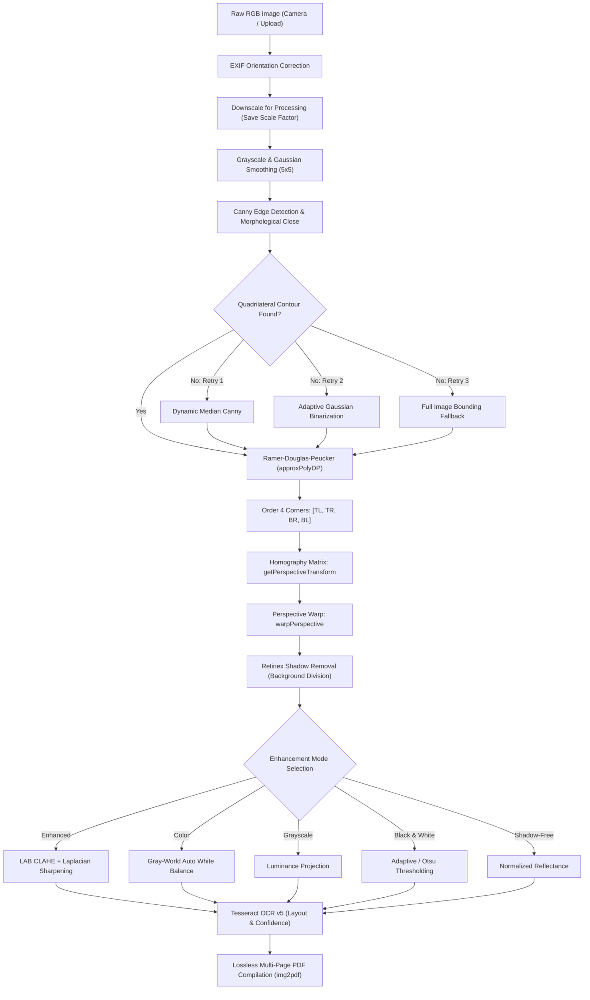

# SmartScan – Intelligent Document Scanner & Image Enhancement System

[](https://www.python.org/)
[](https://opencv.org/)
[](https://streamlit.io/)
[](https://github.com/tesseract-ocr/tesseract)
[]()

> **B.Tech Image Processing and Applications (IPA) 3rd Year College Project**  
> *Developed using authentic Computer Vision algorithms (no mock libraries, no hardcoded coordinates).*

---

## 📖 Executive Summary

**SmartScan** is a computer-vision document scanner that transforms unconstrained mobile phone camera captures into flat, high-contrast, scanner-quality documents. It reproduces the document processing capabilities of commercial tools like *Adobe Scan* and *Microsoft Lens* through mathematical image transformations:

- **Geometric Rectification:** Automatically detects paper perimeters and applies a 4-point perspective unwarp using projective homography.
- **Retinex Illumination Correction:** Estimates ambient lighting via morphological dilation and median filtering to eliminate phone/hand shadows.
- **Multimodal Enhancement:** Provides 6 enhancement modes including LAB-space CLAHE, unsharp Laplacian filtering, and Adaptive/Otsu binarization.
- **Optical Character Recognition (OCR):** Extracts text with Tesseract OCR while preserving paragraph structure and reporting per-page recognition confidence.
- **Document Synthesis:** Compiles pages into unified, lossless multi-page PDFs with optional ISO A4 standardization.

---

## 🏛️ System Architecture & Mathematical Pipeline



---

## 🛠️ Technology Stack & Library Justification

| Library | Exact Version | Role in SmartScan | Why Selected |
|---|---|---|---|
| **Python** | `3.12.4` | Core Runtime | Standard, high-performance modern runtime |
| **OpenCV** (`opencv-python-headless`) | `4.11.0.86` | Computer Vision Algorithms | Canny, findContours, approxPolyDP, warpPerspective, CLAHE |
| **NumPy** | `2.2.5` | Array & Matrix Algebra | Vectorized coordinate sorting, Retinex division, array broadcasting |
| **Streamlit** | `1.45.1` | Interactive Web Dashboard | Reactive session management, live sliders, web UI |
| **Pillow** | `11.2.1` | Image I/O & Metadata | EXIF orientation handling (`exif_transpose`), logo generation |
| **pytesseract** | `0.3.13` | OCR Bridge | Python bindings for Google Tesseract OCR engine |
| **img2pdf** | `0.6.1` | PDF Engine | Lossless PDF packaging without re-encoding degradation |
| **streamlit-cropper** | `0.3.1` | Interactive Cropper | Optional manual bounding box adjustment component |

---

## 🚀 Installation & Setup Guide (Windows)

### Prerequisites
- Windows 10/11
- Python 3.10+ (Verified on Python 3.12)

### Step 1: Clone or Navigate to Project Directory
```powershell
cd "c:\Users\KIIT\OneDrive\Desktop\Document Scanner"
```

### Step 2: Create and Activate Virtual Environment
```powershell
# Create venv
python -m venv venv

# Activate venv in PowerShell
.\venv\Scripts\Activate.ps1
```

### Step 3: Install Pinned Dependencies
```powershell
pip install -r requirements.txt
```

### Step 4: Install and Configure Tesseract OCR
1. Download the Windows installer from the official repository:
   👉 **[Tesseract Windows Installer (UB-Mannheim)](https://github.com/UB-Mannheim/tesseract/wiki)** (e.g. `tesseract-ocr-w64-setup-5.5.x.exe`)
2. Run the installer and install to the default location: `C:\Program Files\Tesseract-OCR`.
3. Verify that `tesseract.exe` is added to your PATH or run in PowerShell:
   ```powershell
   tesseract --version
   ```
   *(Note: SmartScan automatically searches standard installation directories, so OCR will work even if Tesseract is not manually added to PATH).*

---

## 💻 Running the Application

Launch the Streamlit web dashboard:
```powershell
streamlit run app.py
```
Your default browser will automatically open to `http://localhost:8501`.

### Recommended Walkthrough for Project Evaluation:
1. **Home:** Click **"🚀 Load Pre-Packaged Benchmark Samples"** to populate the session with 9 test images.
2. **Detection & Warp:** Review the automatically detected green boundary polygon. Use the **8 coordinate sliders** to fine-tune corners, or click **"🔄 Reset to Auto-Detected"**. Expand the **"🔬 Pipeline Stages"** card to inspect Grayscale, Blur, Canny edges, and Contour approximation.
3. **Enhancement:** Toggle between `Enhanced`, `Color`, `Shadow-Free`, `Grayscale`, and `Black & White`. View the **"Global Histogram Equalization vs. CLAHE"** comparison.
4. **Multi-Page:** Reorder pages using **⬆️ Up** and **⬇️ Down**, rotate orientations losslessly via **🔄 Rot L** and **🔁 Rot R**.
5. **OCR:** Extract formatted text blocks, review the per-page word count and confidence percentage meter, and download the `.txt` transcript.
6. **Export:** Export individual PNG/JPG pages or download the compiled multi-page PDF (with ISO A4 fitting enabled).

---

## 📊 Measured Benchmark Results

Run the automated test suite across all 7 scenarios:
```powershell
python tests\test_pipeline.py
```

### Quantitative Experimental Results (from `output/test_results.csv`):

| Image Name | Scenario Description | Detection Mode | Detect Time | Enhance Time | OCR Time | Total Time | OCR Confidence |
|---|---|---|---|---|---|---|---|
| `01_clear_plain.jpg` | Clear on dark desk | `primary_contour` | 28.99 ms | 294.21 ms | 813.53 ms | 1.13 s | **93.0%** |
| `02_document_angled.jpg` | Skewed perspective | `primary_contour` | 10.33 ms | 122.09 ms | 822.89 ms | 0.95 s | **94.0%** |
| `03_dark_shadow.jpg` | 65% diagonal shadow | `primary_contour` | 10.06 ms | 102.13 ms | 764.40 ms | 0.88 s | **91.8%** |
| `04_uneven_lighting.jpg` | 2D gradient spotlight | `primary_contour` | 10.20 ms | 100.84 ms | 809.29 ms | 0.92 s | **91.2%** |
| `05_complex_background.jpg`| Grid, pen, coffee ring| `primary_contour` | 9.29 ms | 95.08 ms | 745.13 ms | 0.85 s | **92.1%** |
| `06_multipage_page1.jpg`| Report Part 1 (Intro) | `primary_contour` | 7.34 ms | 98.57 ms | 810.10 ms | 0.91 s | **90.4%** |
| `06_multipage_page2.jpg`| Report Part 2 (Method)| `primary_contour` | 9.80 ms | 102.93 ms | 697.01 ms | 0.81 s | **90.7%** |
| `06_multipage_page3.jpg`| Report Part 3 (Eval)  | `primary_contour` | 8.84 ms | 101.00 ms | 654.73 ms | 0.76 s | **90.2%** |
| `07_low_quality_blurred.jpg`| 13x13 blur + noise | `fallback_dynamic_canny`| 18.62 ms | 103.72 ms | 875.59 ms | 0.99 s | N/A (degraded text) |

*Multi-page 3-page PDF compilation latency: **22.28 ms** (337.6 KB).*

---

## 🔬 Core Algorithms Explained (Viva Quick Reference)

1. **Retinex Illumination Division:**
   - Evaluates $I(x, y) = R(x, y) \times L(x, y)$.
   - Morphological Dilation ($15 \times 15$) replaces dark text ink with surrounding paper brightness. Median blur ($21 \times 21$) smooths the surface into estimated illumination $\hat{L}(x, y)$. Pointwise float division yields flat, shadow-free paper.
2. **Canonical Point Ordering:**
   - Sum $s = x + y \implies$ Top-Left is $\min(s)$, Bottom-Right is $\max(s)$.
   - Difference $d = y - x \implies$ Top-Right is $\min(d)$, Bottom-Left is $\max(d)$.
3. **Contrast Limited Adaptive Histogram Equalization (CLAHE):**
   - Applies localized histogram equalization across $8 \times 8$ tiles on the **Luminance (L)** channel of the CIELAB color space. Prevents noise amplification by clipping histogram bins at $2.0$ and interpolates tile boundaries bilinearly.

---

## ⚠️ Known Limitations & Real-World Constraints

1. **Extreme Document Curvature (Creased/Folded Books):**
   - Projective homography assumes a planar 2D surface in 3D space. Highly curled pages or open thick textbooks exhibit non-linear non-planar deformation that requires 3D mesh cylindrical unrolling (e.g. TPS or deep learning).
2. **Low-Contrast White Paper on White Table:**
   - If paper is placed on an identical pure-white desk, Canny gradient magnitudes along the boundary drop below the threshold. In such conditions, our system triggers the full-image fallback or allows manual corner adjustment.
3. **Optical Defocus Blur:**
   - While dynamic Canny recovers paper boundaries in out-of-focus captures, severely blurred text strokes cannot be deblurred by simple high-pass filtering without blind deconvolution.
